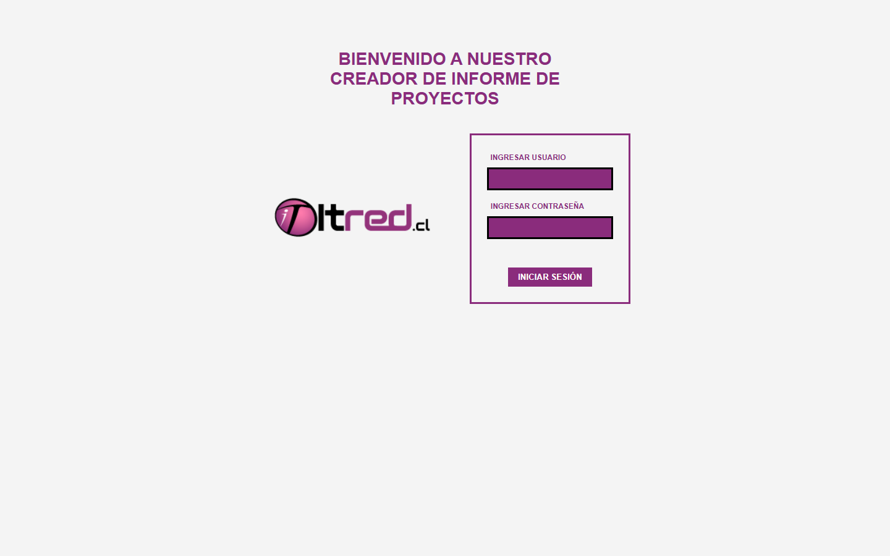
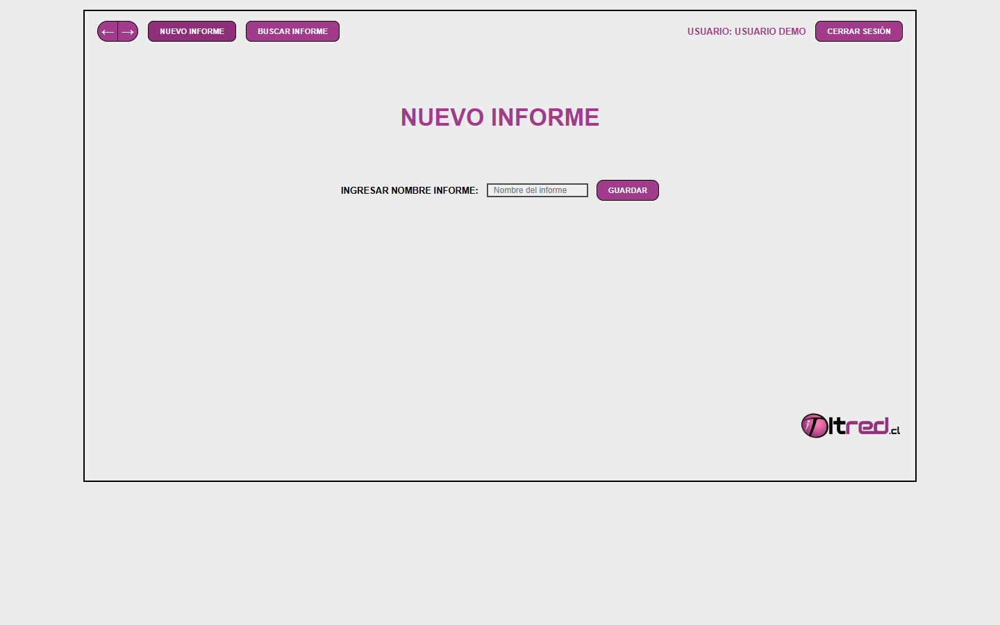
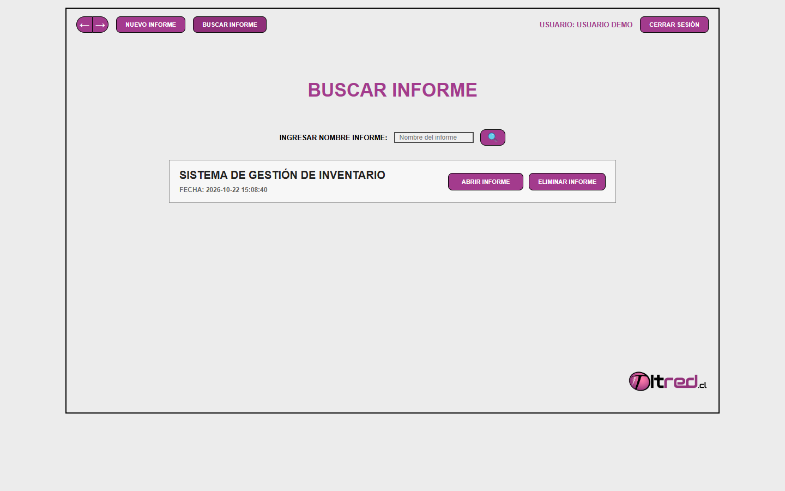
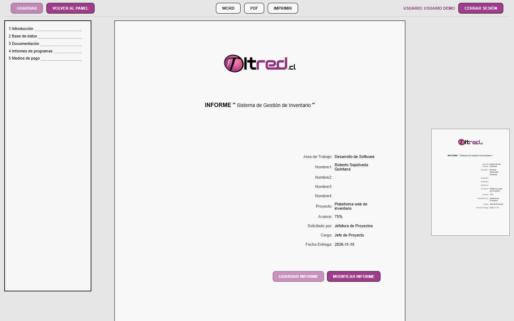
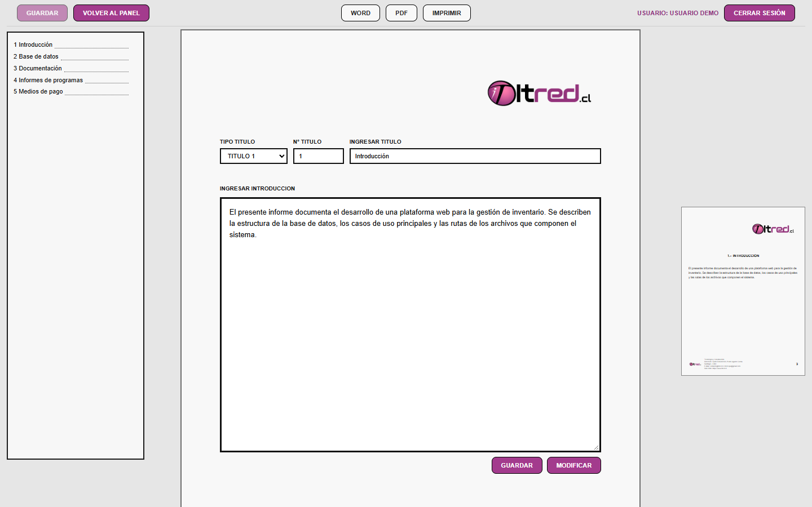
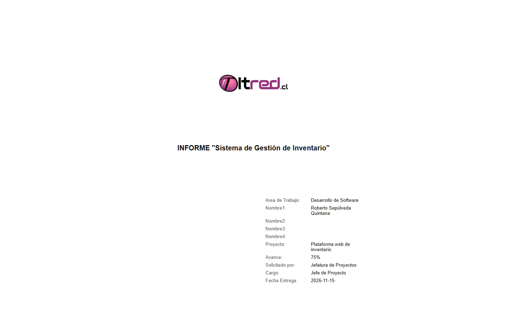
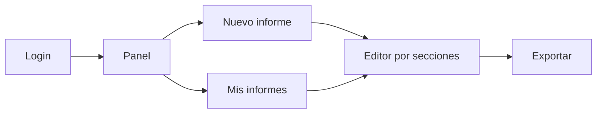
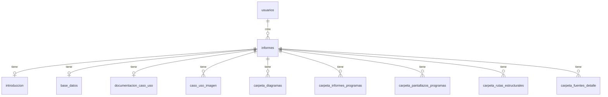

<div align="center">


# Informes App

Generador web de informes técnicos de proyectos, con edición por secciones, índice automático y exportación a Word y PDF.


**[🌐 Demo en vivo](https://informes-app.infinityfreeapp.com/)** · [Capturas](#-capturas) · [Instalación](#-instalación-local)

<sub>Usuario: <code>demo</code> · Contraseña: <code>demo1234</code></sub>

</div>

---

## 📑 Tabla de contenidos

- [¿Qué es?](#-qué-es)
- [Contexto: práctica profesional](#-contexto-práctica-profesional)
- [Capturas](#-capturas)
- [Funcionalidades](#-funcionalidades)
- [¿Cómo funciona?](#-cómo-funciona)
- [Stack tecnológico](#-stack-tecnológico)
- [Arquitectura y modularidad](#-arquitectura-y-modularidad)
- [Estructura del proyecto](#-estructura-del-proyecto)
- [Estándar de escritura de código](#-estándar-de-escritura-de-código)
- [Base de datos](#-base-de-datos)
- [Instalación local](#-instalación-local)
- [Despliegue](#-despliegue)
- [Seguridad](#-seguridad)
- [Aprendizajes](#-aprendizajes)
- [Mejoras futuras](#-mejoras-futuras)
- [Autor](#-autor)
- [Créditos y licencia](#-créditos-y-licencia)

---

## 📌 ¿Qué es?

Aplicación web para crear informes técnicos de proyectos de software de forma estandarizada. Permite redactar cada sección del informe (portada, introducción, base de datos, casos de uso, diagramas y rutas de archivos), genera el índice automáticamente y exporta el documento a Word, PDF o impresión.

## 🏢 Contexto: práctica profesional

Desarrollada durante mi práctica profesional como Analista Programador en ITred Spa, donde también construí sitios web siguiendo metodologías y estándares de código estrictos definidos por la empresa.

## 📸 Capturas

| Inicio de sesión | Panel principal |
|:---:|:---:|
|  |  |
| **Buscar informes** | **Portada del informe** |
|  |  |
| **Edición por secciones** | **Vista de exportación** |
|  |  |

## ✨ Funcionalidades

- **Inicio de sesión** con contraseñas cifradas y sesiones por usuario.
- **Creación y búsqueda de informes**: cada usuario ve y administra solo sus propios informes.
- **Portada editable** con área de trabajo, integrantes, proyecto, avance, solicitante, cargo y fecha de entrega.
- **Edición por secciones**: introducción, base de datos, documentación de casos de uso, imágenes de casos de uso, diagramas, pantallazos, informes de programas y rutas estructurales (medios de pago, envío, reparto, manuales y fuentes).
- **Títulos jerárquicos** (hasta 20 niveles) con numeración propia.
- **Índice automático** generado a partir de los títulos de cada sección, con navegación lateral.
- **Subida de imágenes** (JPG, PNG, GIF, WEBP, hasta 10 MB) con nombres únicos.
- **Vista previa** del documento en tiempo real junto al editor.
- **Exportación** a Word (`.doc`), PDF e impresión con el formato corporativo.
- **Eliminación de informes** con confirmación previa.

## ⚙️ ¿Cómo funciona?



El usuario inicia sesión, crea un informe o busca uno existente y lo completa sección por sección. Cada sección se guarda de forma independiente en la base de datos y alimenta el índice lateral y la vista previa. Al terminar, el informe se exporta con el formato corporativo.

## 🛠️ Stack tecnológico

| Capa | Tecnología | Uso en el proyecto |
|---|---|---|
| Frontend | HTML5, CSS3, JavaScript (vanilla) | Estructura de vistas, estilos por módulo y vista previa en vivo de cada sección |
| Backend | PHP 8 (sin frameworks) | Rutas, validaciones, sesiones, subida de archivos y exportación del informe |
| Base de datos | MySQL / MariaDB (InnoDB, `utf8mb4`) | 11 tablas relacionadas por informe, con eliminación en cascada |
| Entorno | XAMPP (Apache + PHP + MariaDB) | Desarrollo local |
| Hosting | InfinityFree | Demo pública |

## 🧩 Arquitectura y modularidad

Cada módulo tiene su propio archivo PHP, CSS y JS con el mismo nombre en carpetas paralelas. La vista del informe se arma con componentes independientes (`portada_vista_*.php`), y la lógica de datos, las funciones de apoyo y la exportación están en archivos separados.

### Separación por tecnología

Cada pantalla o sección tiene un archivo por tecnología, con el mismo nombre y en la misma ruta relativa dentro de `php/`, `css/` y `js/`. Así, para modificar un módulo se sabe exactamente qué archivos tocar.

| Módulo | PHP | CSS | JS |
|---|---|---|---|
| Login | `login/login.php` | `login/login.css` | `login/login.js` |
| Panel | `informes/panel.php` | `informes/panel.css` | `informes/panel.js` |
| Mis informes | `informes/mis_informes.php` | `informes/mis_informes.css` | `informes/mis_informes.js` |
| Introducción | `informes/portada_vista_introduccion.php` | `informes/introduccion.css` | `informes/introduccion.js` |
| Base de datos | `informes/portada_vista_base_datos.php` | `informes/base_datos.css` | `informes/base_datos.js` |
| Caso de uso (imagen) | `informes/portada_vista_caso_uso_imagen.php` | `informes/caso_uso_imagen.css` | `informes/caso_uso_imagen.js` |
| Diagramas | `informes/portada_vista_carpeta_diagramas.php` | `informes/carpeta_diagramas.css` | `informes/carpeta_diagramas.js` |
| Eliminar informe | `informes/eliminar_informe.php` | `informes/eliminar_informe.css` | `informes/eliminar_informe.js` |

### Componentes de vista

`portada.php` funciona como **orquestador**: procesa los formularios y arma la página incluyendo un componente por sección (`portada_vista_*.php`), como la cabecera, el índice lateral, el documento, la introducción o los diagramas. Las secciones que comparten estructura, como medios de pago, envío y reparto o los manuales, reutilizan un mismo componente genérico (`portada_vista_ruta_estructural.php`) al que solo se le indica qué sección mostrar.

### Capa de datos y funciones

- `portada_datos.php`: todas las consultas a la base de datos (`cargar_*`, `insertar_*`, `guardar_*`), siempre filtradas por el usuario dueño del informe.
- `portada_funciones.php`: funciones de apoyo, como la construcción del índice, la generación de anclas y la limpieza de nombres de archivo.
- `portada_exportacion.php`: genera el HTML del informe final para Word, PDF e impresión, incrustando las imágenes.
- `php/config/conexion.php`: conexión única a la base de datos, configurable por archivo o por variables de entorno.

## 🗂️ Estructura del proyecto

```text
informes_app/
├── bd/
│   └── informes_app_bd.sql
├── css/programa/
│   ├── login/
│   └── informes/
├── js/programa/
│   ├── login/
│   └── informes/
├── php/
│   ├── config/
│   └── programa/
│       ├── login/
│       └── informes/
├── imagenes/
├── documentos/
├── docs/capturas/
└── index.php
```

| Carpeta | Contenido |
|---|---|
| `bd/` | Script SQL con la estructura de la base de datos y el usuario demo |
| `css/programa/` | Hojas de estilo, una por módulo |
| `js/programa/` | Scripts del lado del cliente, uno por módulo |
| `php/config/` | Conexión a la base de datos y plantilla de configuración |
| `php/programa/` | Lógica y vistas, separadas en login e informes |
| `imagenes/` | Logo y carpetas donde se guardan las imágenes que suben los usuarios |
| `docs/capturas/` | Capturas usadas en este README |
| `index.php` | Punto de entrada: carga la conexión y muestra el login |

## 📐 Estándar de escritura de código

El código sigue el estándar de escritura definido por la empresa, aplicado de forma uniforme en PHP, CSS, JS y SQL.

### Nomenclatura

- Nombres de archivos, variables, funciones y tablas **en español** y en `snake_case` (`cargar_introduccion_informe`, `id_informe`, `carpeta_diagramas`).
- Las funciones empiezan con un verbo que indica su acción: `cargar_`, `guardar_`, `insertar_`, `obtener_`, `construir_`.
- Los archivos de un mismo módulo comparten nombre entre PHP, CSS y JS.

### Comentarios y bloques

- Todos los archivos abren y cierran con la **cabecera de la empresa**.
- El archivo completo y cada bloque lógico (conexión, sesión, validaciones, consultas) se delimitan con marcas `INICIO` / `FIN`.
- Cada instrucción relevante lleva un comentario de una línea que explica qué hace.

```php
/* ------------------------
   -- INICIO NOMBRE BLOQUE --
   ------------------------ */

/* ---------------------
   -- FIN NOMBRE BLOQUE --
   --------------------- */
```

### Clases CSS e IDs

- Cada clase lleva como **prefijo el nombre del módulo**, lo que evita choques de estilos entre pantallas: `login_formulario`, `panel_boton_principal`, `portada_columna_contenido`.
- Los IDs siguen la misma lógica y son los que usa JavaScript para conectar con el HTML: `caso_uso_imagen_formulario_principal`, `nivel_titulo_cu_1`.

## 🗄️ Base de datos

La base de datos `informes_app` tiene 11 tablas en InnoDB con codificación `utf8mb4_spanish_ci`. Cada usuario crea informes, y cada informe tiene sus secciones en tablas propias, relacionadas con claves foráneas y `ON DELETE CASCADE`: al borrar un informe se eliminan automáticamente todas sus secciones. Las secciones de contenido único (introducción, base de datos, documentación) admiten un registro por informe, y las de imágenes o rutas admiten varios, ordenados.



## 💻 Instalación local

### Requisitos

- [XAMPP](https://www.apachefriends.org/) con PHP 8.2.35 o superior (ver [Seguridad](#-seguridad)).
- Git, o descargar el proyecto como `.zip` desde GitHub.

### Pasos

1. Clonar el repositorio dentro de la carpeta `htdocs` de XAMPP:
   ```bash
   git clone https://github.com/Z4LT1/informes-app.git C:/xampp/htdocs/informes_app
   ```
2. Iniciar **Apache** y **MySQL** desde el panel de XAMPP.
3. Abrir `http://localhost/phpmyadmin`, crear una base de datos llamada `informes_app` con cotejamiento `utf8mb4_spanish_ci` y seleccionarla.
4. En la pestaña **Importar**, cargar el archivo `bd/informes_app_bd.sql`.
5. Abrir `http://localhost/informes_app/` e ingresar con el usuario `demo` / `demo1234`.

No hace falta configurar la conexión: si no existe `php/config/config.php`, la app usa los valores por defecto de XAMPP (`localhost`, usuario `root`, sin contraseña).

## 🚀 Despliegue

La demo está publicada en **InfinityFree**, un hosting gratuito con PHP y MySQL. Para desplegarla en cualquier hosting similar:

1. Crear una base de datos desde el panel del hosting e importar `bd/informes_app_bd.sql` con phpMyAdmin.
2. Subir los archivos del proyecto a la carpeta pública (`htdocs` o `public_html`).
3. Copiar `php/config/config.example.php` como `php/config/config.php` y completar los datos de conexión del hosting.

`config.php` está en `.gitignore`, así que las credenciales nunca se suben al repositorio. En plataformas que usan variables de entorno, la conexión también lee `DB_HOST`, `DB_USER`, `DB_PASSWORD`, `DB_NAME` y `DB_PORT`.

### Credenciales de prueba

| Demo | Usuario | Contraseña |
|---|---|---|
| [informes-app.infinityfreeapp.com](https://informes-app.infinityfreeapp.com/) | `demo` | `demo1234` |

## 🔐 Seguridad

### Buenas prácticas implementadas

- **Consultas preparadas** (`mysqli::prepare` + `bind_param`) en todas las operaciones con la base de datos, para prevenir inyección SQL.
- **Contraseñas cifradas** con `password_hash` y verificadas con `password_verify`. Si el algoritmo cambia, el hash se actualiza solo al iniciar sesión, y las contraseñas antiguas en texto plano se migran automáticamente.
- **Sesiones seguras**: el identificador se regenera al iniciar sesión (`session_regenerate_id`) para evitar la fijación de sesión, y todas las páginas internas exigen una sesión válida.
- **Aislamiento por usuario**: cada consulta filtra por el `id_usuario` de la sesión, así que nadie puede ver, editar ni borrar informes ajenos aunque cambie el `id_informe` en la URL.
- **Salida escapada** con `htmlspecialchars` para prevenir XSS, y conversión a entero (`(int)`) de los identificadores recibidos.
- **Validación de archivos subidos**: solo se aceptan extensiones de imagen, con un máximo de 10 MB, y se guardan con un nombre aleatorio generado por el servidor.
- **Credenciales fuera del repositorio**: la configuración de conexión se separa en un archivo ignorado por git, y la carpeta `bd/` está protegida con `.htaccess`.

### Caso de estudio: PHP2Shell (CVE-2026-109618 / CVE-2026-109619)

En octubre de 2026 se publicaron dos vulnerabilidades críticas **en el propio intérprete de PHP**, conocidas como **PHP2Shell** (CVSS v4: 9.2). Permiten **ejecución remota de código sin autenticación** y afectan a prácticamente todas las versiones desde PHP 5.4 hasta 8.5. Se corrigieron el 21 de octubre de 2026.

| CVE | Tipo de falla | Cómo se activa |
|---|---|---|
| CVE-2026-109618 | Corrupción de memoria al quedarse sin memoria (OOM) | Una petición, por ejemplo un formulario `multipart` manipulado, agota la memoria mientras PHP prepara la petición, y la limpieza posterior usa datos a medio inicializar. |
| CVE-2026-109619 | *Use-after-free* por estado que queda entre peticiones | Un error fatal deja estado interno apuntando a memoria liberada, y una petición posterior al mismo proceso la reutiliza, por ejemplo a través del seguimiento de progreso de subida de sesiones. |

#### ¿Cómo podría verse afectado este proyecto?

- **La falla está en PHP, no en el código de la aplicación.** Con Apache + `mod_php`, el modo que usa XAMPP y el de mayor riesgo según el equipo de PHP, el ataque puede ocurrir **antes de que se ejecute cualquier línea de la app**. Ni las consultas preparadas ni la validación de formularios lo evitan.
- **El entorno local es vulnerable.** XAMPP trae PHP 8.2.12, anterior a la versión corregida 8.2.35. Apache escucha por defecto en todas las interfaces (`Listen 80`), así que otro equipo de la misma red podría alcanzarlo.
- **La app usa justo las piezas involucradas:**
  - **Formularios `multipart/form-data`** para subir imágenes de casos de uso, diagramas y pantallazos: es el vector descrito para CVE-2026-109618.
  - **Sesiones de PHP** en todo el sistema. `session.upload_progress.enabled` viene activo por defecto y es el camino confirmado de CVE-2026-109619, incluso sin llamar a `session_start()`.
  - **Una cuenta demo pública**, que da acceso a todos los formularios de subida.
- **Impacto posible:** un atacante podría ejecutar código con los permisos del servidor web y, con eso, leer `php/config/config.php` (credenciales de la base de datos), modificar o borrar informes, o usar el servidor para otros ataques.

#### Mitigación

1. **Actualizar PHP**, la única solución completa: 8.2.35, 8.3.36, 8.4.27 o 8.5.12 o superior. En el hosting compartido, confirmar con el proveedor que ya aplicó el parche.
2. **Medidas temporales** en `php.ini` o en la configuración del servidor (no en `ini_set()` ni en `.user.ini`, que llegan tarde), reiniciando Apache después:
   ```ini
   session.upload_progress.enabled = 0
   memory_limit = -1      ; solo mientras no se actualiza, y con límites de petición acotados
   post_max_size = 8M
   upload_max_filesize = 5M
   ```
3. **Reducir la exposición:** en local, limitar Apache a `Listen 127.0.0.1:80`. En producción, poner la app detrás de un WAF; Cloudflare publicó reglas para los vectores conocidos, también en su plan gratuito.
4. **Evitar errores fatales provocables por el usuario**, como agotar la memoria o el tiempo de ejecución con entradas grandes. Ocultar los errores con `@` o `display_errors` **no** cierra la vulnerabilidad.

> Fuentes: [Rapid7](https://www.rapid7.com/blog/post/etr-cve-2026-109618-and-cve-2026-109619-critical-unauthenticated-remote-code-execution-in-php/) · [Tenable](https://www.tenable.com/blog/php2shell-cve-2026-109618-cve-2026-109619-frequently-asked-questions-about-critical-php-remote) · [The Hacker News](https://thehackernews.com/2026/10/php-issues-emergency-patches-for-two.html) · Avisos oficiales GHSA-w8hw-w9fx-j79w y GHSA-6wmf-4rv5-p3rp

## 📚 Aprendizajes

- Trabajar bajo **estándares de código estrictos** definidos por una empresa, y mantenerlos de forma consistente en todo un proyecto.
- Diseñar una **arquitectura modular** sin frameworks, separando vistas, datos, estilos y comportamiento.
- Modelar una **base de datos relacional** con integridad referencial y eliminación en cascada.
- Aplicar **buenas prácticas de seguridad** en PHP: consultas preparadas, cifrado de contraseñas, manejo de sesiones y validación de archivos.
- Transformar requerimientos de documentación en una **herramienta que automatiza** un proceso repetitivo.
- **Recuperar, corregir y desplegar** un proyecto heredado: unificar la codificación, centralizar la configuración y publicarlo en un hosting.

## 🔭 Mejoras futuras

- [ ] Diseño **responsive** para tablets y celulares.
- [ ] **Tokens CSRF** en todos los formularios.
- [ ] Validar el **tipo real** de las imágenes subidas (MIME), no solo la extensión.
- [ ] Exportación a **PDF nativo** y `.docx`, en vez de HTML convertido.
- [ ] **Registro de usuarios** y recuperación de contraseña.
- [ ] **Pruebas automatizadas** y entorno con **Docker**.

## 👤 Autor

**Roberto Sebastián Sepúlveda Quintana**: Analista Programador

[](https://github.com/Z4LT1)
[](https://www.linkedin.com/in/TU_PERFIL)

## 📄 Créditos y licencia

Proyecto desarrollado durante mi práctica profesional en **[ITred Spa](https://www.itred.cl)**. El logo, la marca y el estándar de escritura del código pertenecen a ITred Spa. Este repositorio se publica con fines de portafolio y no tiene licencia de uso comercial.
