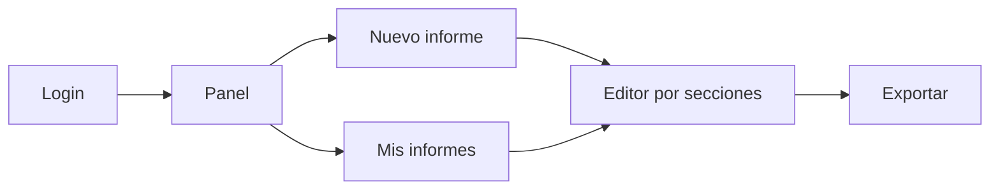
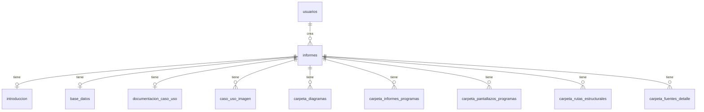

<div align="center">


# Informes App

<!-- Una línea que diga qué es el proyecto -->


[Demo en vivo](#) · [Capturas](#-capturas) · [Instalación](#-instalación-local)

</div>

---

## 📑 Tabla de contenidos

- [¿Qué es?](#-qué-es)
- [Contexto: práctica profesional](#-contexto-práctica-profesional)
- [Capturas](#-capturas)
- [Funcionalidades](#-funcionalidades)
- [¿Cómo funciona?](#-cómo-funciona)
- [Stack tecnológico](#-stack-tecnológico)
- [Arquitectura y modularidad](#-arquitectura-y-modularidad)
- [Estructura del proyecto](#-estructura-del-proyecto)
- [Estándar de escritura de código](#-estándar-de-escritura-de-código)
- [Base de datos](#-base-de-datos)
- [Instalación local](#-instalación-local)
- [Despliegue](#-despliegue)
- [Seguridad](#-seguridad)
- [Aprendizajes](#-aprendizajes)
- [Mejoras futuras](#-mejoras-futuras)
- [Autor](#-autor)
- [Créditos y licencia](#-créditos-y-licencia)

---

## 📌 ¿Qué es?

<!-- Qué problema resuelve, para quién, en 2–4 líneas -->

## 🏢 Contexto: práctica profesional

<!-- Empresa, rol (Analista Programador), período, qué te pidieron -->

## 📸 Capturas

<!-- Reemplaza las rutas por tus capturas (sugerencia: carpeta docs/capturas/) -->

| Login | Panel | Editor de informe |
|:---:|:---:|:---:|
|  |  |  |

<!-- Opcional: un GIF corto del flujo completo -->

## ✨ Funcionalidades

<!-- Lista con viñetas -->

-
-
-

## ⚙️ ¿Cómo funciona?

<!-- Flujo del usuario paso a paso -->



<!-- Explica el diagrama -->

## 🛠️ Stack tecnológico

| Capa | Tecnología | Uso en el proyecto |
|---|---|---|
| Frontend | | |
| Backend | | |
| Base de datos | | |
| Entorno | | |

## 🧩 Arquitectura y modularidad

<!-- Idea principal de la modularidad -->

### Separación por tecnología

<!-- Cada módulo tiene su .php, .css y .js correspondiente -->

| Módulo | PHP | CSS | JS |
|---|---|---|---|
| | | | |

### Componentes de vista

<!-- portada.php como orquestador que incluye portada_vista_*.php -->

### Capa de datos y funciones

<!-- portada_datos.php, portada_funciones.php, portada_exportacion.php -->

## 🗂️ Estructura del proyecto

```text
informes_app/
├── bd/
│   └── informes_app_bd.sql
├── css/programa/
│   ├── login/
│   └── informes/
├── js/programa/
│   ├── login/
│   └── informes/
├── php/programa/
│   ├── login/
│   └── informes/
├── imagenes/
├── documentos/
└── index.php
```

<!-- Breve explicación de cada carpeta -->

## 📐 Estándar de escritura de código

<!-- Reglas que seguías: nomenclatura, comentarios, bloques INICIO/FIN, cabecera, etc. -->

### Nomenclatura

### Comentarios y bloques

```php
/* ------------------------
   -- INICIO NOMBRE BLOQUE --
   ------------------------ */

/* ---------------------
   -- FIN NOMBRE BLOQUE --
   --------------------- */
```

### Clases CSS e IDs

## 🗄️ Base de datos

<!-- Descripción general y relaciones -->



## 💻 Instalación local

<!-- Datos útiles: crear BD `informes_app` en phpMyAdmin → importar bd/informes_app_bd.sql → abrir http://localhost/informes_app/
     Usuario demo: demo / demo1234. Sin config.php se usa localhost/root/sin contraseña. -->

### Requisitos

-
-

### Pasos

1.
2.
3.

```bash
# comandos
```

## 🚀 Despliegue

<!-- Dónde está publicado y cómo.
     Datos útiles: copiar php/config/config.example.php como config.php con los datos del hosting,
     o definir variables de entorno DB_HOST, DB_USER, DB_PASSWORD, DB_NAME, DB_PORT. -->

### Credenciales de prueba

| Usuario | Contraseña |
|---|---|
| | |

## 🔐 Seguridad

<!-- Prepared statements, password_hash, sesiones, htmlspecialchars, etc. -->

## 📚 Aprendizajes

<!-- Qué aprendiste en la práctica -->

## 🔭 Mejoras futuras

- [ ]
- [ ]
- [ ]

## 👤 Autor

<!-- Nombre, LinkedIn, correo, portafolio -->

## 📄 Créditos y licencia

<!-- Mención a la empresa y licencia/permiso de publicación -->
